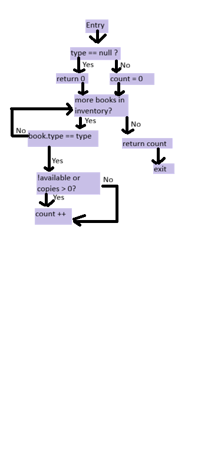

# Assignment 3 White-Box Testing Report

**Student name:** Christina Thompson  
**ASU ID:** Cthomp79  
**Whitebox branch:** `Whitebox`  
**Commit represented by this report:** c2b73730137313231b9de5d9bd1b6624408c0b2b 

## AI-use statement

Choose one and complete it:

- [x] I did not use generative AI for this report or implementation.
- [ ] I used generative AI only for permitted grammar/table-formatting help. Tool and exact use: [describe].

The CFG, test design, tests, implementation, coverage interpretation, and reflection are my own work.

## 1. checkoutBook implementation evidence

| Evidence                                                                     | Commit hash/link or result               |
| ---------------------------------------------------------------------------- | ---------------------------------------- |
| Commit that configures my Assignment 2 tests to run against `Checkout.class` | 8b1f4e853b05c510f08f4b711a31d0e687145e00 |
| Initial `./gradlew blackBoxTest` result before implementation                | === Library Management System Demo ===   |
|                                                                          |                                          |
|  --- Scenario 1: Normal checkout ---                                     |                                          |
|  Student checking out: Mystery Novel                                     |                                          |
|  Result code: 0.0                                                        |                                          |
|  Expected: 0.0 (success)                                                 |                                          |
|                                                                          |                                          |
|  --- Scenario 2: Reference-only book ---                                 |                                          |
|  Student trying to checkout: Data Structures Reference                   |                                          |
|  Result code: 0.0                                                        |                                          |
|  Expected: 5.0 (reference-only)                                          |                                          |
|                                                                          |                                          |
|  --- Scenario 3: Patron with fines ---                                   |                                          |
|  Student has $12.50 in fines                                             |                                          |
|  Trying to checkout: Introduction to Java                                |                                          |
|  Result code: 0.0                                                        |                                          |
|  Expected: 4.1 (fines >= $10)                                            |                                          |
|                                                                          |                                          |
|  --- Scenario 4: Suspended account ---                                   |                                          |
|  Child account is suspended                                              |                                          |
|  Trying to checkout: Children's Stories                                  |                                          |
|  Result code: 0.0                                                        |                                          |
|  Expected: 3.0 (account suspended)                                       |                                          |
|                                                                          |                                          |
|  --- Scenario 5: Testing helper methods ---                              |                                          |
|                                                                          |                                          |
|  validatePatronEligibility() tests:                                      |                                          |
|  Student eligibility: 4.1                                                |                                          |
|  Child eligibility: 3.0                                                  |                                          |
|                                                                          |                                          |
|  calculateFine() tests:                                                  |                                          |
|  5 days overdue (FICTION): $1.25                                         |                                          |
|  10 days overdue (TEXTBOOK): $6.50                                       |                                          |
|  30 days overdue (REFERENCE): $25.00                                     |                                          |
|                                                                          |                                          |
|  isValidISBN() tests:                                                    |                                          |
|  '978-0-1234-5678-9' valid? true                                         |                                          |
|  '123456789X' valid? false                                               |                                          |
|  '978-INVALID' valid? false                                              |                                          |
|                                                                          |                                          |
|  === Demo Complete ===                                                   |                                          |
|                                                                          |                                          |
|  BUILD SUCCESSFUL in 8s                                                  |                                          |
|  4 actionable tasks: 2 executed, 2 up-to-date                            |                                          |
|  Configuration cache entry reused.                                       |                                          |
| Commit containing my `checkoutBook()` implementation                         | b16e86ff7dc6487dd375e5abd51d90a5faf33e22 |
| Final `blackBoxTest` result                                                  | > Task :app:run                          |
|  Hello World!                                                            |                                          |
|                                                                          |                                          |
|  > Task :run                                                             |                                          |
|  === Library Management System Demo ===                                  |                                          |
|                                                                          |                                          |
|  --- Scenario 1: Normal checkout ---                                     |                                          |
|  Student checking out: Mystery Novel                                     |                                          |
|  Result code: 0.0                                                        |                                          |
|  Expected: 0.0 (success)                                                 |                                          |
|                                                                          |                                          |
|  --- Scenario 2: Reference-only book ---                                 |                                          |
|  Student trying to checkout: Data Structures Reference                   |                                          |
|  Result code: 5.0                                                        |                                          |
|  Expected: 5.0 (reference-only)                                          |                                          |
|                                                                          |                                          |
|  --- Scenario 3: Patron with fines ---                                   |                                          |
|  Student has $12.50 in fines                                             |                                          |
|  Trying to checkout: Introduction to Java                                |                                          |
|  Result code: 4.1                                                        |                                          |
|  Expected: 4.1 (fines >= $10)                                            |                                          |
|                                                                          |                                          |
|  --- Scenario 4: Suspended account ---                                   |                                          |
|  Child account is suspended                                              |                                          |
|  Trying to checkout: Children's Stories                                  |                                          |
|  Result code: 3.0                                                        |                                          |
|  Expected: 3.0 (account suspended)                                       |                                          |
|                                                                          |                                          |
|  --- Scenario 5: Testing helper methods ---                              |                                          |
|                                                                          |                                          |
|  validatePatronEligibility() tests:                                      |                                          |
|  Student eligibility: 4.1                                                |                                          |
|  Child eligibility: 3.0                                                  |                                          |
|                                                                          |                                          |
|  calculateFine() tests:                                                  |                                          |
|  5 days overdue (FICTION): $1.25                                         |                                          |
|  10 days overdue (TEXTBOOK): $6.50                                       |                                          |
|  30 days overdue (REFERENCE): $25.00                                     |                                          |
|                                                                          |                                          |
|  isValidISBN() tests:                                                    |                                          |
|  '978-0-1234-5678-9' valid? true                                         |                                          |
|  '123456789X' valid? false                                               |                                          |
|  '978-INVALID' valid? false                                              |                                          |
|                                                                          |                                          |
|  === Demo Complete ===                                                   |                                          |
|                                                                          |                                          |
|  BUILD SUCCESSFUL in 3s                                                  |                                          |
|  4 actionable tasks: 3 executed, 1 up-to-date                            |                                          |
|  Configuration cache entry reused.                                       |                                          |
| Final `whiteBoxTest` result                                                  |                                          |

## 2. Control-flow graph for countBooksByType

Embed your CFG image below. The graph must show entry/exit, executable statement groups, decision outcomes, loop entry/back/exit behavior, and the early return. Use current source line numbers or short statement labels consistently.

### Node legend

| Node | Source line(s) or statement | Role in control flow                       |
| ---- | --------------------------- | ------------------------------------------ |
| N1   | Entry                       | Method Entry Point                         |
| N2   | if (type == null)           | Decision node, validate input type         |
| N3   | return 0;                   | Early return if the book type is null      |
| N4   | int count = 0;              | initialize counter                         |
| N5   | for(Book book : inventory)  | Loop entry and condition                   |
| N6   | book.getType() == type      | Decision node, does the book match the key |
| N7   | !available                  | is the book avaialbe                       |
| N8   | count++;                    | increment the amount of matching books     |
| N9   | return count;               | final return count at end of the loop      |
| N10  | Exit                        | method exits                               |

## 3. Coverage-to-test design

Add as many rows as your design requires; there is no fixed minimum. Collectively, the rows must cover every CFG node and edge. Inputs must be concrete enough that another person could implement the test without guessing.

| Case | Targeted node/edge sequence or decision outcome                        | Concrete inventory setup and method inputs                                                        | Expected return | JUnit test method                     | Why this case is necessary                                                |
| ---- | ---------------------------------------------------------------------- | ------------------------------------------------------------------------------------------------- | ---------------:| ------------------------------------- | ------------------------------------------------------------------------- |
| WB1  | N1 -> N2(True)->N3->N10                                                | Empty inventory. Call countBooksByType(null, false)                                               | 0               | testCountBooksByType_NullType()       | Covers the null-type validation branch and early return path              |
| WB2  | N1->N2(false)->N4->N5(False)->N9->N10                                  | Empty inventory. Call countBooksByType(FICTION, false)                                            | 0               | testCountBooksByType_EmptyInventory() | Covers loop exit without any iterations                                   |
| WB3  | N1->N2(False)->N4->N5(True)->N6(True)->N7(True)->N8->N5(False)->N9-N10 | Inventory contains one Fiction book with 0 available copy. Call countBooksByType(FICTION, false)  | 1               | testCountBooksByType_AllBooks()       | Covers successful type match and increments counter                       |
| WB4  | N1->N2(False)->N4->N5(True)->N6(True)->N7(True)->N8                    | Inventory contains one FICTION book with 1 available copy. Call countBooksByType(FICTION, true)   | 1               | testCountBooksByType_Available()      | Covers available only when searching for matches                          |
| WB5  | N1->N2(False)->N4->N5(True)->N6(True)->N7(False)->N5(False)->N9->N10   | Inventory contains one fiction book with 0 available copies. Call countBooksByType(FICTION, true) | 0               | testCountByType_unavailable()         | Covers the false branch of the availability decision node                 |
| WB6  | N1->N2(False)->N4->N5(True)->N6(False)->N5(False)->N9->N10             | Inventory contains one Textbook. Call countBooksByType(FICTION, false)                            | 0               | testCountBooksByType_TypeMismatch()   | covers the type-mismatch branch                                           |
| WB7  | N1->N2(False)->N4->N5(True)->(continue to loop 5 iterations)->N9-N10   | Inventory contains five fiction books. Call countBooksByType(Fiction, false)                      | 5               | testCountBooksByType_FiveIterations() | Demonstrates the loop of 5 iterations and loop back to the edge coverage. |

### Coverage argument

Identify where your table covers each decision's true and false outcomes and the loop's zero-iteration, iteration/back-edge, and exit behavior. If one test covers several items, name that test rather than repeating its setup.

The above table utilizes the control-flow graph by supporting the three decision points and containing the option for one loop. This supports all the possible outcomes from the white box tests, as well as supports the test for 5 iterations.
The decision node type == null is covered by WB1, which when true executes the early return. When this decision node comes back as false, it allows for further branch processing and the continuation of the other white box tests. 
The next decision node book.getType() == type is checking for a match of types amongst the inventory. When this is true, there is an allowance of WB3-5 and WB7 to be tested.  In the case of false, WB6 (the TEXTBOOK mismatch test) can be executed. 
The third decision node for checking book availability will test WB4 which will be true if the matching book has available copies. In the case that the false branch is taken, WB5 will be exercised since the matching book type has 0 copies. 
The loop is implemented where there is an allowance for a zero-iteration case, but also allows the loop back edge to iterate through five books. This supports WB7 which is established to test the iteration of 5 book types being counted. 

## 4. JaCoCo results

Command used: `./gradlew clean test jacocoTestReport`

Record the final values from `build/reports/jacoco/test/html/index.html`.

| Scope                         | Line coverage | Branch coverage | What this scope tells you                                                                                                                                                    |
| ----------------------------- | -------------:| ---------------:| ---------------------------------------------------------------------------------------------------------------------------------------------------------------------------- |
| Whole project                 | 36%           | 29%             | This represents how much of the application is being tested. A majority of the methods were not tested.                                                                      |
| `Checkout` class              | 43%           | 34%             | This measures how thoroughly the Checkout class is tested. The checkout class tests over important functionality but several methods remain untested.                        |
| `Checkout.countBooksByType()` | 97%           | 91%             | This measures how thorough the whitebox tests in comparison to the method's statements, decisions and loop behaviors. A large majority of branches and methods were covered. |

**Does `countBooksByType()` have complete branch coverage?** [Yes/No] No

If no, identify the exact uncovered decision outcome and specify the additional setup, input, and expected result needed to cover it. If yes, identify the test methods responsible for the last decision outcome you covered.

Based off the JaCoCo report, the branch coverage is missing either a branch option, or the decision outcome for a branch option. In the scenario a null book is counted and added to inventory first, the loop iteration is never executed. This leaves a gap in if there is a valid fiction book later in line after the null book, which creates a new scenario to test for. Implementing an additional test that would create this scenario would provide better code coverage and a higher percentage of methods being tested. 

## 5. Evidence-based analysis and reflection

### Structural insight

Name one test that you designed because you inspected the implementation structure rather than only the JavaDoc. Identify the relevant node/edge and explain why black-box analysis alone might not have suggested it.

The implemented testCountBooksByType_FiveIterations() was created to represent the implementation structure, not just the javaDoc suggestion. This test was meant to represent the loop back-edge in the cfg by providing the opportunity for adding up to 5 fiction books, this also creates an end to the loop so there isn't a continuous repeat once the maximum has been reached. 

### Interpreting coverage

What does your JaCoCo evidence support about your tests? What can it **not** establish about correctness? Refer to at least one percentage and one named test or uncovered condition.

JaCoCo evidence supports that the methods created to test the CountBooksByType() were effective (97% line coverage, 91% branch coverage) and thorough, although another test would provide complete coverage. The report tests whether these methods were effective in providing an outcome for a wide variety of scenarios and if those scenarios provided the expected outcomes. The coverage precentage does not necessarily imply that the uncovered methods are unsuccessful, just that they have not been tested. The implementation of these test methods provided the right outcome, but the logical writing of the tests and the outcomes of unexpected scenarios can still provide feedback on if the program is implemented correctly. Defects could still exist on paths that have been covered by the report, just as they can still exist in untested methods of the program. 

### Black-box compared with white-box testing

Give one concrete contribution from each approach in this assignment. Which combination gave you more confidence in `Checkout`, and why?

I will be honest. My implementation at the beginning of this assignment (BlackBox focus) was not pretty or complete. I was struggling to understand git, github and utilizing repositories and the gradlew features. Blackbox testing is supposed to fous on whether the methods returned the correct status for observable scenarios, not necessarily the inner workings. 
I found whitebox testing (requiring the more indepth approach on how the methods were being tested) to be more fruitful for the overall understanding and testing of the system. Both test approaches are extremely important, but the whitebox testing in combination with the blackbox testing gave a better understanding of observable results. 
I had to go back and make changes/fix original tests in the blackBoxTesting files in order to get gradlew to run the JaCoCo results, in which gave me the opportunity to understand the observable updated in real time with the whitebox methods being implemented. 
JaCoCo still lists the overall project coverage at 36% and branch coverage at 29%, indicating that both blackbox and whitebox testing needs further testing to create a more complete outlook on the program. 

### Remaining risk

Identify one realistic defect or interaction that your current tests might still miss. Explain why it remains outside or weakly represented in your test suite.

The easiest realistic defect interaction is the branch JaCoCo has exposed that is not tested. None of the current tests place a null book into inventory, and black box tests assume the book is available and valid. This will create an issue when the application is implemented and there is a null book entered and the expectations of the inventory system will not provide accurate information. The implementation of a scenario to handle a null book in the inventory will solve this issue. 

## 6. Final submission check

- [ ] The report identifies the exact graded commit.
- [ ] The CFG image renders on GitHub.
- [ ] Every designed case maps to an implemented JUnit method.
- [ ] Student black-box, white-box, and complete test tasks run.
- [ ] JaCoCo values are copied from the final report.
- [ ] All placeholders and instructional rows have been removed.
- [ ] The completed file, CFG image, implementation, and tests are pushed on `Whitebox`.

